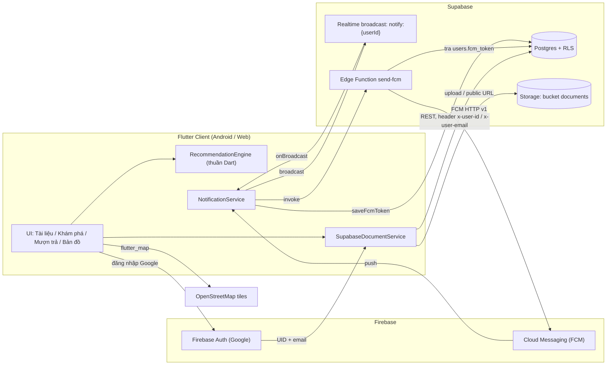
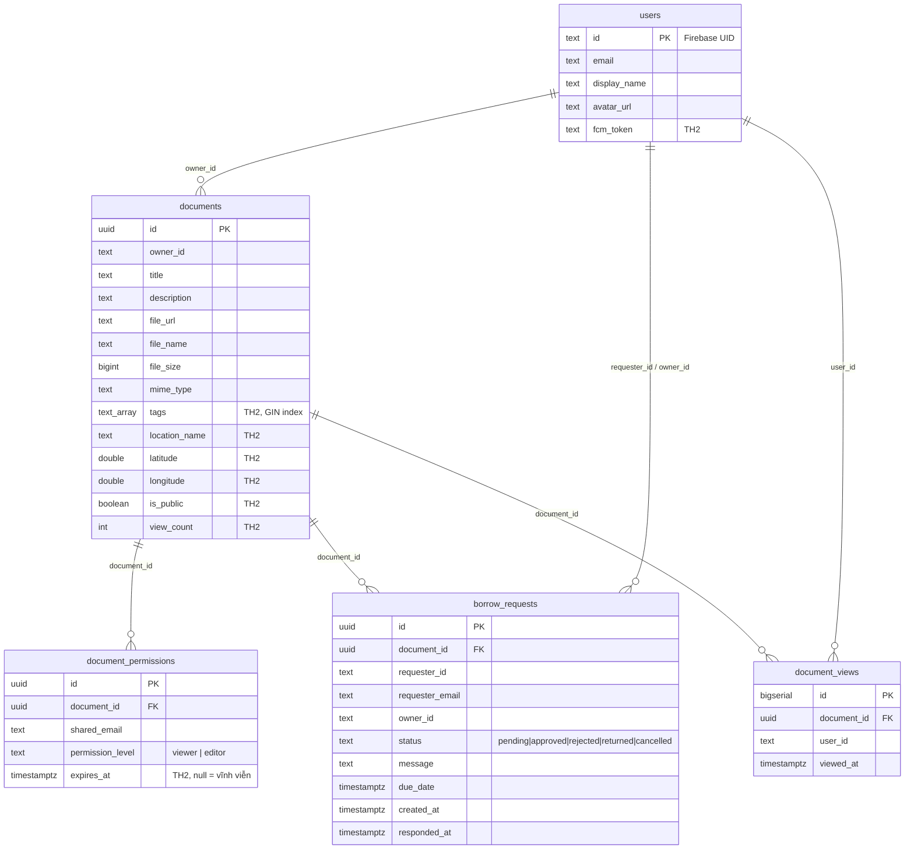
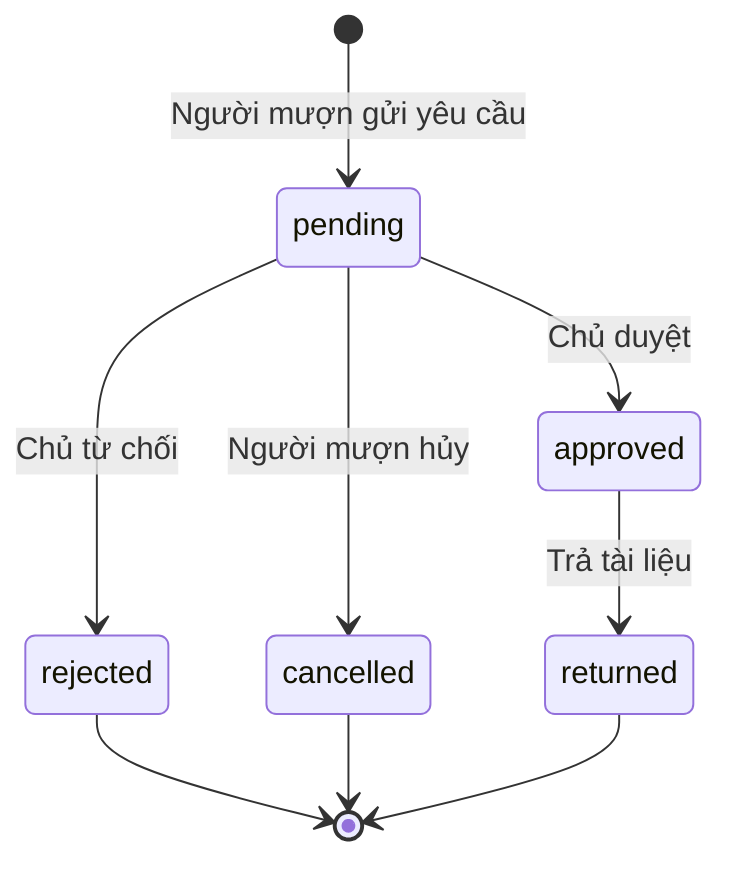
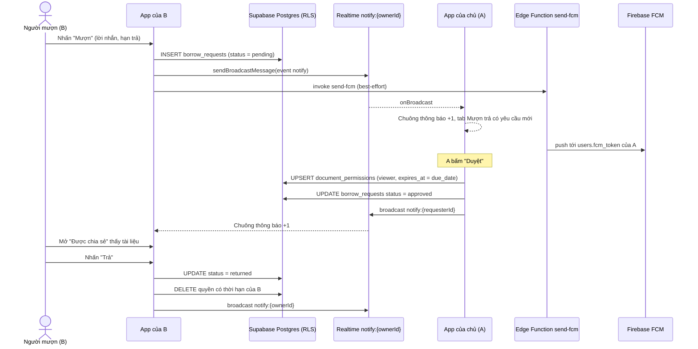

# BÁO CÁO TH2: PHÁT TRIỂN HỆ THỐNG QUẢN LÝ TÀI LIỆU ĐA NỀN TẢNG

Ứng dụng: **StudyDoc Manager** (Flutter, package `study_doc_manager`).
Công nghệ: Flutter (Android, Web) + Firebase (Authentication, Cloud Messaging) + Supabase (PostgreSQL, Storage, Realtime, Edge Function).

> Các ô `[điền kết quả]` là số liệu thực tế nhóm phải điền sau khi chạy lệnh. Báo cáo không ghi sẵn kết quả chưa đo.

Tài liệu liên quan: [HUONG_DAN_CHAY_TH2.md](HUONG_DAN_CHAY_TH2.md), [KICH_BAN_QUAY_VIDEO_TH2.md](KICH_BAN_QUAY_VIDEO_TH2.md).

---

## 1. Kiến trúc và mô hình dữ liệu

### 1.1. Sơ đồ kiến trúc

Firebase đảm nhiệm **danh tính** (Google Sign-In) và **đẩy thông báo** (FCM). Supabase đảm nhiệm **dữ liệu** (Postgres + RLS), **tệp** (Storage bucket `documents`), **thông báo thời gian thực** (Realtime broadcast) và **push server-side** (Edge Function `send-fcm`).



Luồng chính:
1. Người dùng đăng nhập Google qua Firebase Auth, app nhận **UID** và **email**.
2. `SupabaseBootstrap.clientForUser` tạo client Supabase gắn header `x-user-id` và `x-user-email`.
3. Mọi truy vấn đi qua PostgREST; Row Level Security (RLS) lọc từng dòng theo danh tính trong header.
4. Thông báo gửi qua hai đường song song: Realtime broadcast (tức thời khi app đang mở) và Edge Function `send-fcm` (push FCM, best-effort).

### 1.2. Mô hình dữ liệu (ER)



Các cột TH2 được thêm bằng `ALTER TABLE ... ADD COLUMN IF NOT EXISTS`, các bảng mới bằng `CREATE TABLE IF NOT EXISTS`, nên [`supabase/th2_migration.sql`](supabase/th2_migration.sql) chạy lại nhiều lần không lỗi. Chỉ mục: `idx_documents_tags` (GIN trên `tags`), `idx_documents_public` (partial, `WHERE is_public`), `idx_borrow_owner`, `idx_borrow_requester`, `idx_borrow_document`, `idx_views_user (user_id, viewed_at DESC)`, `idx_views_document`.

### 1.3. Tóm tắt chính sách RLS

Tất cả bảng bật RLS. Script xóa toàn bộ policy cũ trên `documents`, `document_permissions`, `borrow_requests`, `document_views` trước khi tạo lại, vì policy PERMISSIVE được OR với nhau: một policy TH1 cũ không kiểm tra hết hạn sẽ làm hở quyền.

| Bảng | Thao tác | Điều kiện |
|---|---|---|
| `users` | SELECT | Mọi người |
| `users` | INSERT / UPDATE | `id = current_app_user_id()` (chỉ hồ sơ của mình) |
| `documents` | SELECT | Chủ sở hữu, hoặc có quyền chia sẻ còn hạn, hoặc `is_public = true` |
| `documents` | INSERT | `owner_id = current_app_user_id()` |
| `documents` | UPDATE | Chủ sở hữu hoặc quyền `editor` còn hạn |
| `documents` | DELETE | Chỉ chủ sở hữu |
| `document_permissions` | SELECT | Chủ tài liệu, hoặc người nhận (đúng email, chưa hết hạn) |
| `document_permissions` | INSERT / UPDATE | Chỉ chủ tài liệu |
| `document_permissions` | DELETE | Chủ tài liệu, hoặc chính người nhận (tự trả quyền) |
| `borrow_requests` | SELECT | `requester_id` hoặc `owner_id` là mình |
| `borrow_requests` | INSERT | Là người mượn, `status = 'pending'`, `owner_id` đúng chủ thật, không tự mượn, tài liệu công khai hoặc đã được chia sẻ |
| `borrow_requests` | UPDATE | Chủ: đổi sang `approved/rejected/returned`. Người mượn: đổi sang `cancelled/returned` |
| `document_views` | SELECT / INSERT | Chỉ dòng của chính mình |
| `storage.objects` (bucket `documents`) | SELECT / INSERT / UPDATE / DELETE | `bucket_id = 'documents'` (bucket đọc công khai, giới hạn 10 MB/tệp) |

Hàm hỗ trợ `SECURITY DEFINER` (tránh đệ quy RLS lỗi 42P17): `is_document_owner`, `check_user_document_permission` (bỏ qua quyền đã hết hạn), `is_document_public`, `document_owner_id`, RPC `record_document_view` (chỉ ghi lượt xem khi người dùng thực sự có quyền xem).

### 1.4. Danh tính qua header và giới hạn bảo mật

Client dùng role `anon` của Supabase (không có JWT Supabase Auth). Danh tính được truyền bằng hai header:

| Header | Nguồn | Hàm SQL đọc |
|---|---|---|
| `x-user-id` | Firebase UID | `current_app_user_id()` (fallback `auth.uid()`) |
| `x-user-email` | Email Google | `current_app_user_email()` (ưu tiên bảng `users`, rồi header, rồi JWT) |

**Giới hạn (cần nêu rõ):** Supabase **không xác minh** hai header này bằng JWT. Bất kỳ ai có `anon key` đều có thể tự đặt `x-user-id` của người khác và vượt qua RLS. Cách này chỉ phù hợp bài thực hành và demo, **không an toàn cho môi trường thật**.

Hướng sản xuất: dùng **Supabase Third-Party Auth với Firebase** để Supabase xác minh Firebase ID token (JWT). Khi đó `auth.uid()` / `auth.jwt()` đáng tin cậy và bỏ được hai header tự khai. Các hàm `current_app_user_id()` và `current_app_user_email()` đã có nhánh fallback `auth.uid()` / `auth.jwt()` nên chuyển đổi không cần viết lại policy.

Ngoài ra bucket `documents` cho phép `anon` ghi/xóa mọi object trong bucket, và URL tệp là public. Lý do giống trên: không có JWT để ràng buộc theo chủ sở hữu.

---

## 2. Giao diện đa nền tảng và responsive

Một codebase Flutter chạy trên Android và Web (Chrome). Bố cục thích ứng theo chiều rộng cửa sổ:

| Chiều rộng | Nhóm | Điều hướng | Bố cục nội dung |
|---|---|---|---|
| < 600 | Compact (điện thoại) | `NavigationBar` dưới đáy | Một cột |
| 600 đến < 840 | Medium (tablet dọc) | `NavigationRail` bên trái | Một cột, rộng hơn |
| 840 đến < 1200 | Expanded (tablet ngang, laptop nhỏ) | `NavigationRail` mở rộng | Lưới nhiều cột / hai khung |
| ≥ 1200 | Large (desktop) | `NavigationRail` mở rộng | Nội dung giới hạn chiều rộng, căn giữa |

Bốn mục điều hướng: **Tài liệu**, **Khám phá**, **Mượn trả**, **Bản đồ**. Chuông thông báo (`notificationBell`) hiển thị số thông báo chưa đọc từ `NotificationService.unread`.

Ví dụ cụ thể trong mã nguồn: `LocationPickerPage` xếp bản đồ và biểu mẫu **cạnh nhau** (bản đồ + khung rộng 380) khi chiều rộng ≥ 840, ngược lại xếp **dọc** (bản đồ trên, biểu mẫu dưới). `CloudUi.compactBreakpoint = 600`, `CloudUi.contentWidth = 960`, `CloudUi.formWidth = 640`.

Cách kiểm chứng: chạy `flutter run -d chrome`, kéo thay đổi kích thước cửa sổ hoặc dùng Chrome DevTools (F12, Ctrl+Shift+M) với các cỡ 390, 700, 1000, 1366 px, chụp ảnh từng cỡ vào báo cáo.

| Cỡ thử | Điều hướng quan sát được | Ảnh minh họa |
|---|---|---|
| 390 px | `[điền kết quả]` | `[chèn ảnh]` |
| 700 px | `[điền kết quả]` | `[chèn ảnh]` |
| 1000 px | `[điền kết quả]` | `[chèn ảnh]` |
| 1366 px | `[điền kết quả]` | `[chèn ảnh]` |

---

## 3. Tag và vị trí

### 3.1. Tag

**Lưu trữ:** cột `documents.tags text[] NOT NULL DEFAULT '{}'`, có chỉ mục **GIN** (`idx_documents_tags`) để lọc theo tag nhanh. Lọc dùng toán tử chứa của PostgREST (`query.contains('tags', [...])`, tương ứng `tags @> ARRAY[...]`): tài liệu phải chứa **tất cả** tag đã chọn.

**Quy tắc chuẩn hóa khi nhập** (`normalizeTag` trong `lib/widgets/tagInput.dart`):

| Quy tắc | Chi tiết |
|---|---|
| Cắt khoảng trắng đầu/cuối | `trim()` |
| Bỏ ký tự `#` đứng đầu | `#flutter` thành `flutter` |
| Chữ thường | `toLowerCase()`, giữ nguyên dấu tiếng Việt |
| Tối đa 24 ký tự | Cắt phần dư |
| Tối đa 10 tag mỗi tài liệu | Ô nhập bị khóa khi đủ |
| Không trùng | Tag đã có bị bỏ qua |
| Tag rỗng bị loại | |

Cách nhập (`TagInput`): gõ rồi nhấn **Enter**, hoặc gõ **dấu phẩy**, hoặc gõ `#tag` rồi nhấn **dấu cách**. Có hàng chip gợi ý (tối đa 8) lấy từ `getAllTags()` (tag của tài liệu riêng, được chia sẻ và công khai). `TagChips` hiển thị `#tag` dạng chip, chạm để chọn lọc.

Ghi chú: `RecommendationEngine.normalizeTag` chuẩn hóa thêm việc gộp nhiều khoảng trắng liên tiếp thành một, để so khớp tag ổn định khi tính gợi ý.

### 3.2. Vị trí

**Lưu trữ:** `location_name` (tên nơi cất giữ), `latitude`, `longitude` (double precision). `SupabaseDocument.hasLocation` đúng khi cả hai tọa độ khác null.

| Thành phần | Công nghệ | Chi tiết |
|---|---|---|
| Bản đồ | `flutter_map` + OpenStreetMap | Tile `https://tile.openstreetmap.org/{z}/{x}/{y}.png`, `userAgentPackageName = com.studydoc.study_doc_manager`, ghi nguồn "© OpenStreetMap contributors" |
| Chọn vị trí | `LocationPickerPage` | Chạm bản đồ để đặt ghim; trả về `PickedLocation` (điểm, tên, cờ `cleared`) |
| Vị trí hiện tại | `geolocator` | Kiểm tra dịch vụ vị trí bật, xin quyền, lấy vị trí độ chính xác cao, timeout 15 giây |
| Tên nơi cất giữ | Ô nhập + chip gợi ý | "Tủ tài liệu phòng 301", "Thư viện trường", "Nhà riêng", "Phòng học nhóm" |
| Xóa vị trí | Nút "Xóa vị trí" | `updateDocument(locationName: '')` đặt cả ba cột về null |
| Tab Bản đồ | `DocumentMapView` | Hiển thị mọi tài liệu có vị trí, tự fit khung khi có nhiều hơn một ghim, nút phóng to/thu nhỏ; chạm ghim để mở tài liệu |

Tâm bản đồ mặc định: Hà Nội (21.0285, 105.8542).

Điều kiện chạy: lấy vị trí hiện tại trên **Web** cần `localhost` hoặc `https`; tile OSM cần Internet.

---

## 4. Luồng mượn và chia sẻ

### 4.1. Phân biệt chia sẻ và mượn

| | Chia sẻ trực tiếp | Mượn |
|---|---|---|
| Người khởi xướng | Chủ tài liệu (nhập email, chọn `viewer`/`editor`) | Người dùng khác gửi yêu cầu cho chủ |
| Điều kiện | Chủ chọn người nhận | Tài liệu công khai hoặc đã được chia sẻ |
| Quyền cấp | `viewer` hoặc `editor` | Luôn `viewer`, có hạn (`expires_at = due_date`) |
| Kết thúc | Chủ thu hồi | Người mượn trả, hoặc quyền tự hết hạn |

### 4.2. Máy trạng thái yêu cầu mượn



Nhãn hiển thị (`BorrowStatus.label`): Đang chờ duyệt, Đã duyệt, Bị từ chối, Đã trả, Đã hủy.

Ràng buộc nghiệp vụ trong `SupabaseDocumentService`:
- Chủ sở hữu không thể mượn tài liệu của chính mình.
- Mỗi người chỉ có một yêu cầu `pending` cho cùng một tài liệu.
- `approveBorrow`: upsert quyền `viewer` với `expires_at = dueDate`, rồi đặt `approved`. Nếu người mượn đã có quyền **không thời hạn** (`expires_at` null) thì **không hạ cấp** quyền đó.
- `returnBorrow`: đặt `returned` rồi xóa quyền **có thời hạn** của người mượn (quyền vĩnh viễn được giữ).
- Cập nhật trạng thái ghi `responded_at`.

### 4.3. Sơ đồ tuần tự với thông báo thời gian thực



Cơ chế thông báo (`NotificationService`):
- `listenForUser(userId)` đăng ký kênh Realtime `notify:{userId}`, sự kiện `notify`.
- `sendToUser(...)` gửi broadcast tới kênh của người nhận, sau đó gọi Edge Function `send-fcm` (timeout 2 giây, lỗi bị bỏ qua nếu chưa deploy).
- `initialize()` xin quyền FCM, lấy token (Web dùng `FIREBASE_VAPID_KEY`), lắng nghe `onMessage`. Không làm gì nếu Firebase chưa sẵn sàng hoặc nền tảng không hỗ trợ.
- Lịch sử giữ tối đa 50 thông báo trong bộ nhớ; `unread` là `ValueNotifier<int>` cho chuông.
- Edge Function `supabase/functions/send-fcm/index.ts` tra `users.fcm_token`, lấy access token từ service account (`FIREBASE_SERVICE_ACCOUNT`), gọi FCM HTTP v1. Nếu người dùng chưa có token, trả `sent: false`.

Kênh Realtime hoạt động **không cần** deploy Edge Function; FCM push là kênh bổ sung.

### 4.4. Hết hạn quyền

- `document_permissions.expires_at` rỗng nghĩa là vĩnh viễn.
- RLS và hàm `check_user_document_permission` chỉ tính quyền khi `expires_at IS NULL OR expires_at > now()`. Quyền hết hạn **mất hiệu lực ngay ở tầng cơ sở dữ liệu**, không cần job dọn dẹp.
- Client cũng bỏ quyền hết hạn khi dựng danh sách "Được chia sẻ" (`getDocuments`).
- Dòng quyền hết hạn vẫn nằm trong bảng cho đến khi bị xóa; hiệu lực bị chặn bởi điều kiện lọc.
- Không có job tự đặt `borrow_requests.status = returned` khi quá hạn: trạng thái yêu cầu chỉ đổi khi người dùng thao tác.

---

## 5. Thuật toán gợi ý

Cài đặt trong `lib/cloud/recommendationEngine.dart` (thuần Dart, không phụ thuộc Flutter hay Supabase, nên kiểm thử đơn vị trực tiếp). Gợi ý chạy **trên client** từ danh sách ứng viên là tài liệu công khai của người khác.

### 5.1. Hồ sơ sở thích

Mỗi tag được cộng điểm thô theo nguồn, sau đó chia cho điểm thô lớn nhất để trọng số lớn nhất bằng 1:

| Nguồn | Điểm cộng cho mỗi tag |
|---|---|
| Mỗi tài liệu **sở hữu** | +1.0 |
| Mỗi tài liệu **đã xem** | +1.5 |
| Mỗi tag **yêu thích** (người dùng đặt) | +2.0 |

### 5.2. Công thức điểm

Với từng ứng viên *c* (loại tài liệu của chính mình và tài liệu đã nằm trong danh sách sở hữu):

```
content_raw(c) = Σ profile[t] với t là tag của c trùng hồ sơ  /  √(số tag của c)
content(c)     = content_raw(c) / max(content_raw của mọi ứng viên)      (0 nếu max = 0)
pop(c)         = ln(1 + viewCount) / ln(1 + maxViewCount)                 (thang log, 0..1)
fresh(c)       = exp(-ageDays / 30)                                       (bán rã ~30 ngày)

Có hồ sơ:   score = 0.7·content + 0.2·pop + 0.1·fresh
Cold start: score = 0.7·pop + 0.3·fresh
```

| Thành phần | Có hồ sơ | Cold start |
|---|---|---|
| Nội dung (trùng tag) | 0.7 | 0 |
| Phổ biến | 0.2 | 0.7 |
| Độ mới | 0.1 | 0.3 |

Chia cho √(số tag) là chuẩn hóa kiểu cosine: tài liệu gắn quá nhiều tag không được lợi thế chỉ vì nhiều tag.

### 5.3. Cold start

**Cold start** xảy ra khi hồ sơ rỗng (chưa sở hữu, chưa xem tài liệu có tag, chưa đặt tag yêu thích). Khi đó chỉ xếp theo phổ biến và độ mới, và lý do hiển thị là "Phổ biến". Người dùng thoát cold start bằng cách chọn tag yêu thích trong tab Khám phá.

### 5.4. Sắp xếp, lý do và bổ sung

- Sắp theo điểm giảm dần; hòa điểm thì `createdAt` mới hơn trước, rồi theo `id` (kết quả xác định).
- Lý do hiển thị: `Trùng tag: #a, #b` nếu có tag trùng; ngược lại "Phổ biến" (nếu `pop ≥ fresh`) hoặc "Mới đăng".
- Có hồ sơ: nếu số tài liệu trùng tag đủ `limit` thì chỉ trả tài liệu trùng tag; thiếu thì bổ sung tài liệu không trùng (điểm thấp hơn nên đứng sau).

### 5.5. Ví dụ tính tay

Hồ sơ: sở hữu 1 tài liệu tag `[dart, flutter]`, đã xem 1 tài liệu tag `[flutter]`, tag yêu thích `[firebase]`.

Điểm thô: dart = 1.0, flutter = 1.0 + 1.5 = 2.5, firebase = 2.0. Chia cho 2.5: **flutter = 1.0, firebase = 0.8, dart = 0.4**.

Giả sử `maxViewCount = 100` trong nhóm ứng viên.

| Ứng viên | Tag | Lượt xem | Tuổi (ngày) | content_raw | content | pop | fresh | Điểm |
|---|---|---|---|---|---|---|---|---|
| A | flutter, dart | 10 | 0 | (1.0 + 0.4)/√2 = 0.990 | 1.000 | ln11/ln101 = 0.520 | 1.000 | 0.7·1.000 + 0.2·0.520 + 0.1·1.000 = **0.904** |
| B | firebase | 100 | 30 | 0.8/√1 = 0.800 | 0.808 | 1.000 | e⁻¹ = 0.368 | 0.7·0.808 + 0.2·1.000 + 0.1·0.368 = **0.802** |
| C | java | 0 | 60 | 0 | 0 | 0 | e⁻² = 0.135 | 0.7·0 + 0.2·0 + 0.1·0.135 = **0.014** |

Thứ tự: A, B, C. Lý do: A "Trùng tag: #flutter, #dart", B "Trùng tag: #firebase", C "Mới đăng" (vì `pop = 0 < fresh`). Vì chỉ có 2 tài liệu trùng tag, ít hơn `limit = 10`, C được bổ sung ở cuối.

Các test trong `test/recommendation_test.dart` kiểm tra trọng số hồ sơ (`dart = 1.0`, `x = 0.4`, `firebase = 0.8`) bằng một ví dụ tương tự.

---

## 6. Kiểm thử và đóng gói

### 6.1. Danh sách kiểm thử

| Tệp | Loại | Nội dung |
|---|---|---|
| `test/recommendation_test.dart` | Unit | Chuẩn hóa tag; trọng số hồ sơ; tài liệu trùng tag xếp trên; loại tài liệu của mình; cold start dùng độ phổ biến; tôn trọng `limit` và bổ sung; hòa điểm xác định; tài liệu đã xem tăng điểm (8 test) |
| `test/database_test.dart` | Unit | Tầng cơ sở dữ liệu cục bộ (TH1) |
| `test/service_test.dart` | Unit | Tầng nghiệp vụ `DocumentService` (TH1) |
| `test/cloud_policy_test.dart` | Unit | Chính sách tải tệp (kích thước, đuôi tệp, tên tệp, giới hạn metadata) |
| `test/widget_test.dart` | Widget | Kiểm thử giao diện |
| `test/firebase_rules.test.cjs` | Rules (Node) | Firestore/Storage Rules trên Emulator (TH trước) |

Các test trên chạy mà không cần Supabase thật. **Chưa có test tự động** cho RLS của Supabase hoặc luồng mượn đầu-cuối; các phần này được kiểm bằng thao tác thủ công trong video demo.

### 6.2. Lệnh kiểm thử

```powershell
flutter test                         # toàn bộ test Dart và widget
flutter test test/recommendation_test.dart   # riêng thuật toán gợi ý
flutter analyze                      # phân tích tĩnh
npm run test:rules                   # test Firebase Rules (cần Node >= 22, firebase-tools)
```

| Lệnh | Kết quả | Ngày chạy |
|---|---|---|
| `flutter test` | `[điền kết quả: x/y test đạt]` | `[điền ngày]` |
| `flutter test test/recommendation_test.dart` | `[điền kết quả]` | `[điền ngày]` |
| `flutter analyze` | `[điền kết quả: số cảnh báo/lỗi]` | `[điền ngày]` |
| `npm run test:rules` | `[điền kết quả]` | `[điền ngày]` |

### 6.3. Đóng gói

```powershell
flutter build web                    # đầu ra: build/web
flutter build apk --release          # đầu ra: build/app/outputs/flutter-apk/app-release.apk
```

Nếu đã cấu hình Firebase, thêm `--dart-define-from-file=firebase_config.json` (và `--dart-define=FIREBASE_VAPID_KEY=...` cho push Web) vào cả hai lệnh.

| Sản phẩm | Đường dẫn | Dung lượng | Kết quả build |
|---|---|---|---|
| Web | `build/web` | `[điền kết quả]` | `[điền kết quả]` |
| APK release | `build/app/outputs/flutter-apk/app-release.apk` | `[điền kết quả]` | `[điền kết quả]` |

Giới hạn đã biết: `flutter build apk --release` hiện ký bằng khóa debug (`signingConfig = signingConfigs.getByName("debug")` trong `android/app/build.gradle`); APK này dùng để demo, không phát hành cửa hàng.

---

## Kết luận và hướng phát triển

**Đã thực hiện:** kiến trúc Firebase (Auth, FCM) + Supabase (Postgres, Storage, Realtime, Edge Function); tag có chỉ mục GIN và lọc theo tất cả tag; vị trí với OpenStreetMap, `geolocator` và tab Bản đồ; luồng mượn với năm trạng thái và quyền có hạn do RLS thực thi; thông báo thời gian thực qua Realtime broadcast, FCM là kênh bổ sung; gợi ý dựa trên tag, độ phổ biến, độ mới, có xử lý cold start; giao diện responsive Android và Web.

**Hạn chế:**
- Danh tính qua header `x-user-id` / `x-user-email` không được Supabase xác minh (mục 1.4); bucket Storage cho `anon` ghi/xóa.
- Gợi ý tính trên client từ danh sách công khai, chưa tối ưu cho dữ liệu lớn.
- Quyền hết hạn bị chặn ở RLS nhưng trạng thái yêu cầu mượn không tự chuyển khi quá hạn.
- Push FCM cần cấu hình Firebase thật và triển khai Edge Function; không có chúng thì chỉ còn thông báo Realtime khi app đang mở.
- Chưa có test tự động cho RLS và luồng mượn.

**Hướng phát triển:**
1. Bật Supabase Third-Party Auth với Firebase JWT, bỏ header tự khai, ràng buộc Storage theo thư mục `{uid}/`.
2. Job định kỳ (pg_cron) đánh dấu yêu cầu quá hạn và xóa quyền hết hạn; nhắc hạn trả bằng push.
3. Chuyển phần chấm điểm gợi ý xuống Postgres (hàm SQL hoặc `pgvector`) khi dữ liệu lớn.
4. Test tích hợp RLS bằng Supabase local (`supabase start`) và pgTAP.
5. Tìm kiếm toàn văn (`tsvector`) và gom cụm ghim trên bản đồ khi có nhiều tài liệu.
