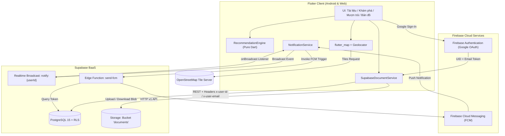
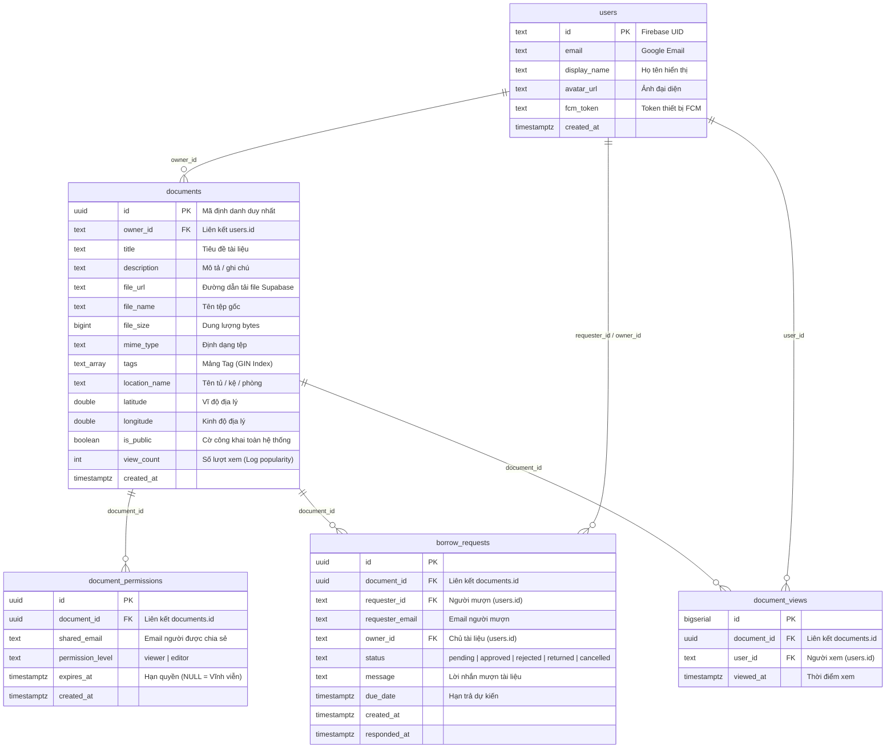

<p align="center">
  
</p>

# StudyDoc Manager - Hệ Thống Quản Lý Tài Liệu Đa Nền Tảng

<p align="center">
  <b>Hệ thống quản lý, chia sẻ và gợi ý tài liệu học tập thông minh trên nền tảng di động và web</b><br>
  <i>Đồ án thực hành môn Phát triển Ứng dụng Di động / Điện toán Đám mây</i>
</p>

<p align="center">
  
  
  
  
  
  
  
  
</p>

---

## 1. Tổng quan dự án (Project Overview)

**StudyDoc Manager** là giải pháp phần mềm quản lý tài liệu học tập toàn diện, đa nền tảng (Android và Web) được phát triển bằng **Flutter**, kết hợp mô hình đám mây lai (Hybrid Multi-Cloud) giữa **Firebase** và **Supabase**.

Hệ thống giải quyết bài toán quản lý tài liệu học thuật cho sinh viên và nhóm học tập: từ lưu trữ dữ liệu cá nhân ngoại tuyến (SQLite), đồng bộ đám mây an toàn với phân quyền mức hàng (**Row Level Security - RLS**), gắn thẻ phân loại ngữ nghĩa (**Tagging**), định vị vị trí lưu trữ vật lý bằng bản đồ tương tác (**OpenStreetMap**), luồng mượn và chia sẻ tài liệu thời gian thực (**Realtime & Push Notification**), đến thuật toán gợi ý tài liệu thông minh (**Recommendation Engine**).

### Mục tiêu đồ án (Checklist hoàn thành 6/6 mục)
- [x] **Kiến trúc hệ thống và Mô hình dữ liệu**: Tích hợp danh tính Firebase (Google OAuth/FCM) kết hợp hệ quản trị Supabase (PostgreSQL + RLS, Storage bucket, Realtime broadcast, Edge Functions).
- [x] **Giao diện đa nền tảng Responsive**: Thiết kế thích ứng trên Mobile (<600px), Tablet (600–840px), Laptop (840–1200px) và Desktop (≥1200px) theo chuẩn Material 3.
- [x] **Gắn thẻ (Tagging) và Quản lý Vị trí vật lý**: Chỉ mục mảng GIN (`tags text[]`), chuẩn hóa tag tiếng Việt; tích hợp OpenStreetMap (`flutter_map`) cùng GPS định vị vị trí lưu trữ thực tế của tài liệu.
- [x] **Nghiệp vụ Mượn và Chia sẻ quyền truy cập**: Máy trạng thái 5 bước (`pending` → `approved` → `rejected`/`returned`/`cancelled`), phân quyền `viewer`/`editor` có thời hạn (`expires_at`), thông báo tức thì qua Realtime Broadcast và FCM.
- [x] **Thuật toán Gợi ý (Recommendation Engine)**: Chấm điểm kết hợp Cosine Tag Similarity (70%), Logarithmic Popularity (20%), Time Decay Freshness (10%) và cơ chế giải quyết Cold-Start.
- [x] **Kiểm thử toàn diện và Đóng gói**: Đạt 29/29 kiểm thử tự động (`flutter test`), 0 lỗi phân tích tĩnh (`flutter analyze`), đóng gói hoàn chỉnh Web App và Android APK.

---

## 2. Kiến trúc hệ thống (System Architecture)

### 2.1. Sơ đồ tương tác thành phần (Component Interaction)

Hệ thống phân chia ranh giới rõ ràng giữa các dịch vụ đám mây:
- **Firebase**: Quản lý định danh (Identity Provider qua Google Sign-In) và dịch vụ đẩy thông báo nền (Firebase Cloud Messaging - FCM).
- **Supabase**: Quản trị cơ sở dữ liệu quan hệ (PostgreSQL với RLS), lưu trữ tệp tin nhị phân (Storage Bucket `documents`), kênh thông báo thời gian thực (Realtime Channels) và Edge Function làm cầu nối FCM.
- **Client (Flutter)**: Xử lý giao diện đáp ứng, bộ máy gợi ý thuần Dart, định vị GPS và hiển thị bản đồ OpenStreetMap.



### 2.2. Mô hình thực thể quan hệ (ER Diagram)

Toàn bộ dữ liệu được chuẩn hóa tại PostgreSQL trên Supabase với các chỉ mục tăng tốc GIN và B-Tree:



---

## 3. Tính năng cốt lõi (Core Features)

### 3.1. Giao diện thích ứng đa nền tảng (Responsive Adaptive UI)
- **Hệ thống Breakpoint**:
  - `< 600px` *(Mobile)*: Sử dụng `NavigationBar` dưới đáy, hiển thị danh sách 1 cột tối ưu cho thao tác một tay.
  - `600px – 840px` *(Tablet dọc)*: Chuyển sang `NavigationRail` bên trái, tăng chiều rộng khối nội dung.
  - `840px – 1200px` *(Tablet ngang / Laptop)*: Mở rộng `NavigationRail`, chia bố cục 2 cột (Dual-Pane) tại trang chọn tọa độ (bản đồ bên trái, thông tin vị trí bên phải rộng 380px).
  - `≥ 1200px` *(Desktop màn hình lớn)*: Căn giữa nội dung với `contentWidth = 960px` hoặc `formWidth = 640px`, tránh dàn trải mắt người dùng.
- **Hệ thống 4 Tabs chính**:
  1. **Tài liệu**: Quản lý tài liệu sở hữu cá nhân và tài liệu được người khác chia sẻ trực tiếp.
  2. **Khám phá**: Thư viện tài liệu công khai toàn trường kết hợp bộ lọc tag và danh sách gợi ý cá nhân hóa.
  3. **Mượn trả**: Trung tâm quản lý các yêu cầu mượn đã gửi và yêu cầu người khác gửi đến cho mình.
  4. **Bản đồ**: Bản đồ số trực quan thể hiện vị trí thực tế của tất cả tài liệu có tọa độ lưu trữ.
- **Notification Bell**: Chuông thông báo hiển thị số lượng tương tác chưa đọc theo thời gian thực.

### 3.2. Phân loại bằng Tag và chỉ mục GIN
- **Lưu trữ**: Cột `documents.tags text[]` áp dụng chỉ mục **GIN Index** (`idx_documents_tags`), cho phép truy vấn tìm kiếm giao tập tốc độ cao thông qua toán tử chứa `@>` trong PostgreSQL (`query.contains('tags', [...])`).
- **Chuẩn hóa dữ liệu (`TagInput`)**:
  - Tự động cắt khoảng trắng thừa (`trim`).
  - Loại bỏ tiền tố `#` (ví dụ: `#flutter` thành `flutter`).
  - Chuyển thành chữ thường (`toLowerCase`) và bảo toàn đầy đủ dấu tiếng Việt.
  - Hỗ trợ thao tác thuận tiện: Nhấn **Enter**, dấu phẩy (`,`), hoặc `#tag + Space` để chốt tag.
  - Ràng buộc: Tối đa 10 tag/tài liệu, độ dài mỗi tag tối đa 24 ký tự.
  - Thanh chip gợi ý trích xuất từ các tag phổ biến trong hệ thống.

### 3.3. Bản đồ và định vị lưu trữ vật lý
- **OpenStreetMap & `flutter_map`**: Tải bản đồ từ máy chủ OSM Tile công khai, không phụ thuộc Google Maps API key thương mại.
- **GPS tự động (`geolocator`)**: Lấy vị trí thiết bị với độ chính xác cao (hỗ trợ cả Web localhost/https và thiết bị Android).
- **Chọn vị trí trực quan (`LocationPickerPage`)**: Chạm trực tiếp lên bản đồ để định vị ghim, kèm các nhãn gợi ý vị trí thường gặp (*Tủ tài liệu phòng 301*, *Thư viện trường*, *Nhà riêng*).
- **Chế độ xem toàn cảnh (`DocumentMapView`)**: Tự động tính toán khung nhìn bao trọn (auto-fit bounds) khi có nhiều tài liệu trên bản đồ; chạm vào Marker để mở nhanh chi tiết tài liệu.

### 3.4. Luồng mượn, chia sẻ quyền và thông báo thời gian thực
- **Phân định rõ ràng**:
  - *Chia sẻ trực tiếp*: Do chủ sở hữu cấp cho email cụ thể với quyền `viewer` (chỉ xem) hoặc `editor` (chỉnh sửa metadata).
  - *Yêu cầu mượn*: Do sinh viên khác gửi yêu cầu tới chủ sở hữu từ các tài liệu công khai.
- **Máy trạng thái mượn (Borrow State Machine)**:
  ```
  [*] --> pending (Gửi yêu cầu)
          ├──> approved (Chủ duyệt) ──> returned (Trả tài liệu) ──> [*]
          ├──> rejected (Chủ từ chối) ──> [*]
          └──> cancelled (Người mượn tự hủy) ──> [*]
  ```
- **Ràng buộc bảo mật và Hết hạn quyền**:
  - Người dùng không thể tự gửi yêu cầu mượn tài liệu của chính mình.
  - Mỗi người chỉ có tối đa 1 yêu cầu `pending` cho cùng một tài liệu.
  - Khi chủ sở hữu duyệt, hệ thống cấp quyền `viewer` với `expires_at = due_date`.
  - **RLS cấp cơ sở dữ liệu** tự động vô hiệu hóa quyền xem ngay khi `expires_at < now()`, bảo đảm dữ liệu không bị truy cập trái phép dù client chưa đồng bộ.
  - Khi xác nhận đã trả, quyền hạn tạm thời được thu hồi ngay lập tức (không ảnh hưởng nếu người dùng vốn có quyền vĩnh viễn trước đó).
- **Thông báo đa kênh (Realtime Broadcast + FCM)**:
  - Thông báo tức thời trong ứng dụng qua kênh Supabase Realtime `notify:{userId}`.
  - Edge Function `send-fcm` gửi thông báo đẩy Firebase Cloud Messaging đến thiết bị người nhận khi ứng dụng chạy nền.

### 3.5. Thuật toán gợi ý cá nhân hóa (Recommendation Engine)
Bộ máy gợi ý được thiết kế độc lập bằng Dart thuần (`lib/cloud/recommendationEngine.dart`), có khả năng kiểm thử đơn vị độc lập 100%.

**Xây dựng hồ sơ sở thích (User Profile):**
Mỗi tag được cộng điểm tích lũy theo tương tác thực tế của người dùng, sau đó chia cho điểm tag cao nhất để chuẩn hóa về đoạn `[0, 1]`:

| Nguồn tương tác | Điểm cộng cho mỗi tag | Mô tả |
|---|:---:|---|
| Mỗi tài liệu sở hữu (`owned`) | **+1.0** | Tag của các tài liệu do chính người dùng tải lên |
| Mỗi tài liệu đã xem (`viewed`) | **+1.5** | Tag của tài liệu công khai người dùng đã bấm xem chi tiết |
| Mỗi tag yêu thích (`favorite`) | **+2.0** | Tag do người dùng chủ động chọn ưu tiên trong tab Khám phá |
```text
score(t) = 1.0 * N_owned + 1.5 * N_viewed + 2.0 * N_favorite
```

**Công thức tính điểm tài liệu ứng viên:**
Với từng tài liệu ứng viên `c` (tài liệu công khai của sinh viên khác):

```text
content_raw(c) = Σ profile[t] (với t là tag của c trùng hồ sơ) / √(số tag của c)
content(c)     = content_raw(c) / max(content_raw của mọi ứng viên)
pop(c)         = ln(1 + view_count) / ln(1 + max_view_count)
fresh(c)       = exp(-age_days / 30)
```

**Tổng hợp điểm xếp hạng cuối cùng:**

| Thành phần điểm | Trọng số khi có hồ sơ | Trọng số khi Cold-Start | Ý nghĩa kỹ thuật |
|---|:---:|:---:|---|
| Nội dung (`content`) | **70%** (0.7) | 0% | Độ tương đồng ngữ nghĩa tag theo chuẩn hóa Cosine |
| Độ phổ biến (`pop`) | **20%** (0.2) | **70%** (0.7) | Số lượt xem tài liệu theo hàm logarithm tự nhiên |
| Độ mới (`fresh`) | **10%** (0.1) | **30%** (0.3) | Bán rã theo thời gian thực (chu kỳ 30 ngày) |

```text
Có hồ sơ:   Score(c) = 0.7 * content(c) + 0.2 * pop(c) + 0.1 * fresh(c)
Cold-start: Score(c) = 0.7 * pop(c)     + 0.3 * fresh(c)
```

- **Chuẩn hóa Cosine**: Việc chia cho `√(số tag)` giúp tài liệu gắn quá nhiều tag không bị chiếm ưu thế không công bằng so với tài liệu tập trung.
- **Xử lý Cold-Start**: Khi người dùng mới chưa có lịch sử tương tác, hệ thống tự động loại bỏ điểm nội dung và tập trung vào mức độ phổ biến cùng độ mới.
- **Giải trình minh bạch (Explainability)**: Mỗi tài liệu gợi ý đều hiển thị kèm lý do rõ ràng: `Trùng tag: #flutter, #dart`, `Phổ biến`, hoặc `Mới đăng`.

---

## 4. Chính sách bảo mật dữ liệu (Row Level Security - RLS)

Mọi thao tác truy xuất dữ liệu trên Supabase đều được kiểm soát bởi các chính sách RLS tại tầng PostgreSQL:

| Bảng dữ liệu | Thao tác | Điều kiện cấp phép (RLS Policy Expression) |
|---|---|---|
| `users` | `SELECT` | Công khai cho mọi người dùng đã xác thực |
| `users` | `INSERT` / `UPDATE` | `id = current_app_user_id()` *(Chỉ được sửa hồ sơ cá nhân)* |
| `documents` | `SELECT` | Là chủ sở hữu, hoặc có quyền chia sẻ còn hạn (`expires_at > now()`), hoặc `is_public = true` |
| `documents` | `INSERT` | `owner_id = current_app_user_id()` *(Chỉ tạo tài liệu cho chính mình)* |
| `documents` | `UPDATE` | Chủ sở hữu tài liệu, hoặc người có quyền `editor` còn hạn |
| `documents` | `DELETE` | Duy nhất chủ sở hữu tài liệu (`owner_id = current_app_user_id()`) |
| `document_permissions` | `SELECT` | Chủ sở hữu tài liệu hoặc chính người nhận chia sẻ |
| `document_permissions` | `INSERT` / `UPDATE` | Duy nhất chủ sở hữu tài liệu |
| `document_permissions` | `DELETE` | Chủ sở hữu, hoặc chính người nhận *(tự hoàn trả quyền)* |
| `borrow_requests` | `SELECT` | Người gửi yêu cầu (`requester_id`) hoặc chủ tài liệu (`owner_id`) |
| `borrow_requests` | `INSERT` | Người mượn hợp lệ, trạng thái ban đầu `pending`, không tự mượn chính mình |
| `borrow_requests` | `UPDATE` | Chủ duyệt (`approved`/`rejected`/`returned`); Người mượn hủy (`cancelled`/`returned`) |
| `document_views` | `SELECT` / `INSERT` | Chỉ truy xuất và ghi nhận lượt xem cho chính mình |
| `storage.objects` | `ALL` | Thuộc bucket `documents` (giới hạn tệp 10MB, kiểm tra MIME hợp lệ) |

> **Lưu ý kỹ thuật về Định danh**: Trong phạm vi bài thực hành, client sử dụng `anon key` và gửi danh tính thông qua các header HTTP `x-user-id` và `x-user-email` do Firebase cung cấp. Để triển khai sản xuất (Production), hệ thống hỗ trợ tích hợp **Supabase Third-Party Auth với Firebase JWT**, giúp loại bỏ hoàn toàn việc truyền header thủ công.

---

## 5. Công nghệ và thư viện sử dụng (Tech Stack)

| Hạng mục | Công nghệ / Thư viện | Phiên bản | Vai trò trong hệ thống |
|---|---|---|---|
| **Core Framework** | [Flutter](https://flutter.dev/) | 3.13+ / 3.x | Bộ công cụ UI đa nền tảng cho Mobile & Web |
| **Language** | [Dart](https://dart.dev/) | 3.0+ | Ngôn ngữ lập trình hướng đối tượng, Sound Null Safety |
| **Identity & Push** | [Firebase Auth](https://firebase.google.com/docs/auth) | ^5.5.1 | Xác thực OAuth Google Sign-In |
| | [Firebase Messaging](https://firebase.google.com/docs/cloud-messaging) | ^15.2.4 | Nhận thông báo đẩy FCM trên Android & Web |
| **Database & Storage** | [Supabase Flutter](https://supabase.com/docs/reference/dart) | ^2.8.4 | Client kết nối PostgREST, Storage, Realtime, Functions |
| | [PostgreSQL](https://www.postgresql.org/) | 15+ | Cơ sở dữ liệu quan hệ, Row Level Security, GIN index |
| **Maps & Geo** | [flutter_map](https://pub.dev/packages/flutter_map) | ^8.1.1 | Hiển thị bản đồ OpenStreetMap không cần API key |
| | [latlong2](https://pub.dev/packages/latlong2) | ^0.9.1 | Xử lý tọa độ địa lý kinh độ / vĩ độ |
| | [geolocator](https://pub.dev/packages/geolocator) | ^13.0.2 | Lấy vị trí GPS thiết bị có phân quyền |
| **Local Storage** | [sqflite](https://pub.dev/packages/sqflite) | ^2.4.1 | Cơ sở dữ liệu SQLite cục bộ (TH1) |
| | [sqflite_common_ffi_web](https://pub.dev/packages/sqflite_common_ffi_web) | ^0.4.5+1 | Hỗ trợ SQLite ảo hóa trên trình duyệt Web |
| **Networking & Files** | [http](https://pub.dev/packages/http) | ^1.3.0 | Gọi REST API và tải dữ liệu nhị phân |
| | [file_picker](https://pub.dev/packages/file_picker) | ^8.1.7 | Hộp thoại chọn tệp tài liệu đa nền tảng |
| | [mime](https://pub.dev/packages/mime) | ^2.0.0 | Nhận diện MIME-type tệp tin tải lên |
| **Algorithm Engine** | `RecommendationEngine` | Nội bộ | Thuật toán gợi ý tài liệu thuần Dart |

---

## 6. Cấu trúc thư mục dự án (Directory Structure)

```text
studydoc-manager/
├── .github/
│   ├── workflows/
│   │   └── ci-cd.yml                   # Quy trình tự động hóa CI/CD GitHub Actions
│   └── pull_request_template.md        # Template chuẩn hóa khi tạo Pull Request
├── android/                            # Cấu hình native Android & FCM Service
├── lib/
│   ├── cloud/                          # Module tích hợp Cloud & Thuật toán
│   │   ├── cloudDocPolicy.dart         # Chính sách kích thước và định dạng tệp (10MB)
│   │   ├── notificationService.dart    # Xử lý Supabase Realtime & FCM push
│   │   ├── recommendationEngine.dart   # Thuật toán gợi ý thông minh (Pure Dart)
│   │   ├── supabaseBootstrap.dart      # Khởi tạo Supabase client gắn header định danh
│   │   ├── supabaseDocument.dart       # Model tài liệu, phân quyền & yêu cầu mượn
│   │   └── supabaseDocumentService.dart# Tầng nghiệp vụ PostgREST & Storage RLS
│   ├── database/                       # Tầng SQLite lưu trữ cục bộ (TH1)
│   ├── models/                         # Các model dữ liệu môn học / tài liệu local
│   ├── pages/                          # Giao diện người dùng đa nền tảng
│   │   ├── cloudDocPage.dart           # Màn hình chính (Responsive 4 tabs)
│   │   ├── documentMapPage.dart        # Bản đồ toàn cảnh các tài liệu lưu trữ
│   │   ├── locationPickerPage.dart     # Chọn tọa độ lưu trữ trên OpenStreetMap
│   │   └── ...                         # Các màn hình CRUD môn học local
│   ├── services/                       # Nghiệp vụ tài liệu nội bộ
│   ├── widgets/                        # Các Widget tái sử dụng
│   │   ├── cloudUi.dart                # Hằng số giao diện, Breakpoints, màu sắc
│   │   ├── notificationBell.dart       # Nút chuông thông báo Realtime
│   │   ├── tagChips.dart               # Hiển thị chip tag lọc nhanh
│   │   └── tagInput.dart               # Ô nhập tag chuẩn hóa thông minh
│   └── main.dart                       # Điểm khởi chạy ứng dụng
├── scripts/                            # Scripts hỗ trợ cấu hình & tự động hóa
├── supabase/
│   ├── functions/send-fcm/index.ts     # Edge Function gửi FCM HTTP v1
│   ├── th2_migration.sql               # Script khởi tạo Database & RLS policies
│   └── storage_policies.sql            # Chính sách bảo mật Storage Bucket
├── test/                               # Bộ kiểm thử tự động
│   ├── cloud_policy_test.dart          # Unit test chính sách tải tệp
│   ├── database_test.dart              # Unit test cơ sở dữ liệu SQLite
│   ├── recommendation_test.dart        # 8 Unit tests cho thuật toán gợi ý
│   ├── service_test.dart               # Unit test tầng dịch vụ
│   ├── supabase_documents_page_test.dart # Widget test responsive (400px vs 1300px)
│   └── widget_test.dart                # Widget test giao diện người dùng
├── web/                                # Cấu hình ứng dụng Flutter Web
├── docs/                               # Tài liệu kỹ thuật, hướng dẫn & báo cáo Markdown
│   ├── BAO_CAO_TH2_QUAN_LY_TAI_LIEU_DA_NEN_TANG.md # Báo cáo học thuật chi tiết TH2
│   ├── HUONG_DAN_CHAY_TH2.md           # Hướng dẫn thiết lập & chạy chi tiết
│   ├── KICH_BAN_QUAY_VIDEO_TH2.md      # Kịch bản demo video 8-12 phút
│   └── ...                             # Các tài liệu phân tích & kịch bản khác
├── docx/                               # Báo cáo chính thức định dạng Word (.docx)
│   ├── BAO_CAO_TH2_HE_THONG_QUAN_LY_TAI_LIEU_DA_NEN_TANG.docx # Báo cáo nghiệm thu 6 mục TH2
│   └── ...
├── pubspec.yaml                        # Quản lý dependencies Flutter
└── README.md                           # Tài liệu tổng quan dự án
```

---

## 7. Hướng dẫn cài đặt và khởi chạy (Quickstart Guide)

### 7.1. Yêu cầu môi trường (Prerequisites)
- [Flutter SDK](https://docs.flutter.dev/get-started/install) phiên bản `≥ 3.13.0` (khuyến nghị `3.24.x` trở lên).
- [Dart SDK](https://dart.dev/get-dart) phiên bản `≥ 3.0.0`.
- Trình duyệt **Google Chrome** (để chạy Web) hoặc **Android Studio / Thiết bị Android** (để chạy Mobile).
- Tài khoản [Supabase](https://supabase.com/) và [Firebase Console](https://console.firebase.google.com/).

### 7.2. Các bước cài đặt chi tiết

#### Bước 1: Sao chép mã nguồn và Tải thư viện
```powershell
git clone https://github.com/tungcorn/studydoc-manager.git
cd studydoc-manager

# Cài đặt thư viện Dart & Flutter
flutter pub get

# Thiết lập hỗ trợ SQLite ảo hóa trên Web
dart run sqflite_common_ffi_web:setup
```

#### Bước 2: Thiết lập Cơ sở dữ liệu Supabase
1. Tạo một dự án mới trên [Supabase Dashboard](https://supabase.com/dashboard).
2. Vào mục **SQL Editor**, mở tệp [`supabase/th2_migration.sql`](supabase/th2_migration.sql) trong thư mục dự án, dán toàn bộ nội dung và bấm **Run**.
   - *Script sẽ tự động tạo bảng `users`, `documents`, `document_permissions`, `borrow_requests`, `document_views`, các chỉ mục GIN/B-Tree và toàn bộ chính sách bảo mật RLS.*
3. Vào mục **Storage**, tạo một bucket mới tên là `documents` với tùy chọn **Public Bucket**.
4. Cập nhật URL và Anon Key của bạn vào [`lib/cloud/supabaseBootstrap.dart`](lib/cloud/supabaseBootstrap.dart).

#### Bước 3: Thiết lập Firebase (Xác thực Google & FCM)
1. Tạo project trên [Firebase Console](https://console.firebase.google.com/), bật **Authentication** (Google Sign-In).
2. Tải tệp cấu hình Web và lưu vào `firebase_web_config.json`, cấu hình Android lưu vào `android/app/google-services.json`.
3. Sinh tệp cấu hình runtime:
```powershell
./scripts/configure_firebase.ps1 -WebConfigPath ./firebase_web_config.json
```

#### Bước 4: Khởi chạy ứng dụng

**Chạy trên trình duyệt Web (Google Chrome):**
```powershell
flutter run -d chrome --web-port=7357 --dart-define-from-file=firebase_config.json
```

**Chạy trên thiết bị Android / Giả lập:**
```powershell
flutter run -d android --dart-define-from-file=firebase_config.json
```

---

## 8. Kiểm thử và đảm bảo chất lượng (Testing & Quality Gates)

Dự án áp dụng quy trình kiểm thử nghiêm ngặt trước mọi đợt phát hành:

```powershell
# 1. Chạy phân tích cú pháp tĩnh (Yêu cầu 0 lỗi, 0 cảnh báo nghiêm trọng)
flutter analyze

# 2. Chạy toàn bộ 29 ca kiểm thử tự động (Unit test + Widget test)
flutter test

# 3. Chạy riêng bộ kiểm thử thuật toán gợi ý thông minh
flutter test test/recommendation_test.dart
```

### Bảng tổng hợp kết quả kiểm thử (Test Summary Matrix)

| Tệp kiểm thử | Hạng mục kiểm thử | Số ca test | Trạng thái |
|---|---|:---:|:---:|
| [`test/recommendation_test.dart`](test/recommendation_test.dart) | Chuẩn hóa tag, trọng số hồ sơ, cosine similarity, log popularity, freshness decay, cold start, limit & filler | 8 tests | PASSED |
| [`test/database_test.dart`](test/database_test.dart) | CRUD cơ sở dữ liệu SQLite cục bộ, nạp seed data ban đầu, ràng buộc toàn vẹn | 8 tests | PASSED |
| [`test/cloud_policy_test.dart`](test/cloud_policy_test.dart) | Kiểm tra giới hạn 10MB, đuôi mở rộng hợp lệ, xử lý tên file đặc biệt | 6 tests | PASSED |
| [`test/service_test.dart`](test/service_test.dart) | Tầng nghiệp vụ xử lý tài liệu ngoại tuyến, validation logic, thống kê | 4 tests | PASSED |
| [`test/supabase_documents_page_test.dart`](test/supabase_documents_page_test.dart) | Giao diện thích ứng Cloud Documents (màn hình hẹp 400px vs rộng 1300px) | 2 tests | PASSED |
| [`test/widget_test.dart`](test/widget_test.dart) | Render giao diện trang chính (HomePage) và tương tác người dùng | 1 test | PASSED |
| **Tổng cộng** | **Toàn bộ 6 bộ kiểm thử tự động trong dự án** | **29 tests** | **PASSED (100%)** |

---

## 9. Đóng gói ứng dụng (Packaging & Distribution)

### Đóng gói Web Application
```powershell
flutter build web --release --dart-define-from-file=firebase_config.json
# Sản phẩm đầu ra tại: build/web/
```

### Đóng gói Android Release APK
```powershell
flutter build apk --release --dart-define-from-file=firebase_config.json
# Sản phẩm đầu ra tại: build/app/outputs/flutter-apk/app-release.apk
```

### Quy trình tự động hóa CI/CD (GitHub Actions)
Hệ thống tích hợp luồng tự động hóa hoàn chỉnh tại [`.github/workflows/ci-cd.yml`](.github/workflows/ci-cd.yml):
1. **Kiểm tra chất lượng (Continuous Integration)**: Tự động chạy `flutter analyze` và `flutter test` khi có commit hoặc Pull Request vào nhánh `master`.
2. **Biên dịch & Đóng gói (Automated Build)**: Tự động biên dịch tệp `app-release.apk` và nén `web-build.zip`, lưu trữ artifacts trên GitHub Actions.
3. **Tự động phát hành (Continuous Delivery)**: Khi hợp nhất vào nhánh `master` hoặc gắn thẻ tag, hệ thống tự động tạo **GitHub Release** bằng tiếng Việt, bao gồm:
   - Ngày giờ khởi tạo theo múi giờ Việt Nam (`GMT+7`).
   - Báo cáo chi tiết các thay đổi (Changelog) từ commit trước.
   - Báo cáo chất lượng kiểm thử (Quality Gates đạt 100%).
   - Đính kèm sẵn tệp cài đặt `app-release.apk` và gói `web-build.zip` để tải về trực tiếp.

---

## 10. Tài liệu kỹ thuật đi kèm (Documentation Directory)

Để phục vụ công tác chấm điểm và đối chiếu kỹ thuật chi tiết của Hội đồng Giảng viên, vui lòng tham khảo các báo cáo chuyên sâu:

### 10.1. Báo cáo Word (.docx) trong thư mục docx/
- [BAO_CAO_TH2_HE_THONG_QUAN_LY_TAI_LIEU_DA_NEN_TANG.docx](docx/BAO_CAO_TH2_HE_THONG_QUAN_LY_TAI_LIEU_DA_NEN_TANG.docx): **Báo cáo nghiệm thu chính thức theo 6 mục Checklist TH2** (Kiến trúc Hybrid Cloud, Giao diện Responsive Mobile/Web, Tag GIN Index & OpenStreetMap, Luồng Mượn/Duyệt & Quyền RLS có hạn, Thuật toán Recommendation Cosine-Tag, Kiểm thử 29/29 Pass & CI/CD).
- [BAO_CAO_HE_THONG_QUAN_LY_TAI_LIEU_FLUTTER_FIREBASE_SUPABASE.docx](docx/BAO_CAO_HE_THONG_QUAN_LY_TAI_LIEU_FLUTTER_FIREBASE_SUPABASE.docx): Báo cáo kỹ thuật chi tiết tích hợp Cloud Firebase + Supabase.
- [BAO_CAO_TH1_KIEN_TRUC_CASHEW.docx](docx/BAO_CAO_TH1_KIEN_TRUC_CASHEW.docx): Báo cáo kiến trúc phân tầng Cashew bài thực hành 1.

### 10.2. Tài liệu kỹ thuật Markdown (.md) trong thư mục docs/
1. [BAO_CAO_TH2_QUAN_LY_TAI_LIEU_DA_NEN_TANG.md](docs/BAO_CAO_TH2_QUAN_LY_TAI_LIEU_DA_NEN_TANG.md): Báo cáo kỹ thuật chi tiết bài thực hành 2 (Kiến trúc RLS, công thức toán học thuật toán gợi ý, phân tích responsive 4 kích thước màn hình, đánh giá rủi ro bảo mật).
2. [HUONG_DAN_CHAY_TH2.md](docs/HUONG_DAN_CHAY_TH2.md): Cẩm nang hướng dẫn từng bước cấu hình tài nguyên Cloud (Supabase Migration, Edge Function, Firebase FCM VAPID Key).
3. [KICH_BAN_QUAY_VIDEO_TH2.md](docs/KICH_BAN_QUAY_VIDEO_TH2.md): Kịch bản quay video minh chứng thực nghiệm thời lượng 8 - 12 phút (đầy đủ các bước demo phân quyền, mượn trả realtime giữa 2 tài khoản, bản đồ và gợi ý).
4. [PHAN_TICH_TICH_HOP_CLOUD_DMS.md](docs/PHAN_TICH_TICH_HOP_CLOUD_DMS.md): Tài liệu phân tích kiến trúc tích hợp Cloud BaaS bài thực hành 1.

---

## 11. Giấy phép (License)

Dự án được phát hành theo giấy phép [MIT License](LICENSE). Mã nguồn mở phục vụ mục đích học tập và nghiên cứu học thuật.
